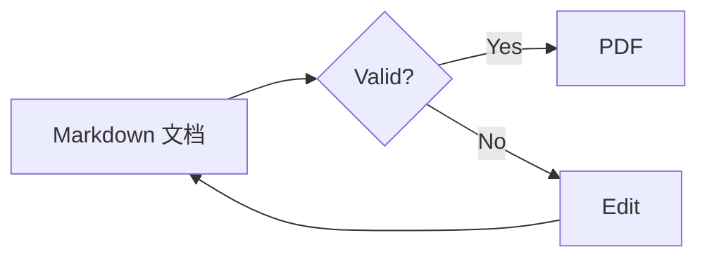
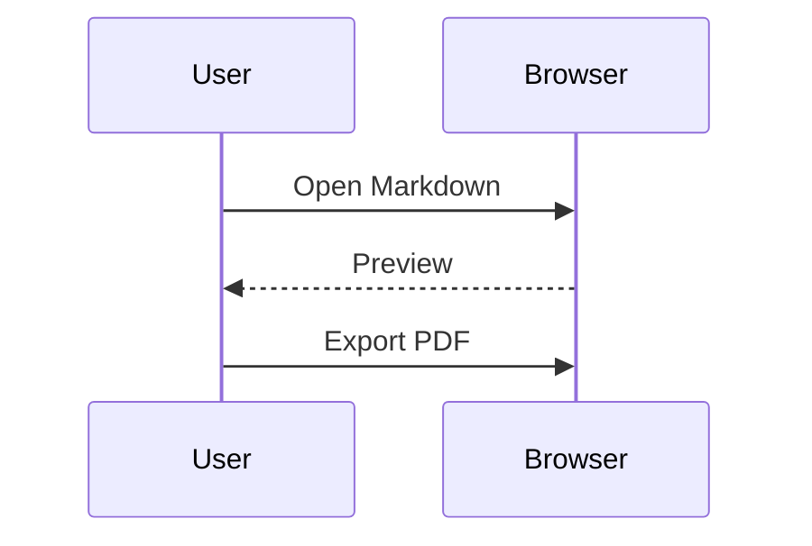

# Code and diagrams

## JavaScript

```javascript
// A highlighted function
const greet = (name) => `Hello, ${name}!`;
console.log(greet("World"));
```

## Python

```python
def square(value: int) -> int:
    return value ** 2
print(square(7))
```

## Flowchart



## Sequence



## Plain text fallback

```unknown-language
<script>Not executable</script>
```

Inline math still works: $E=mc^2$.
